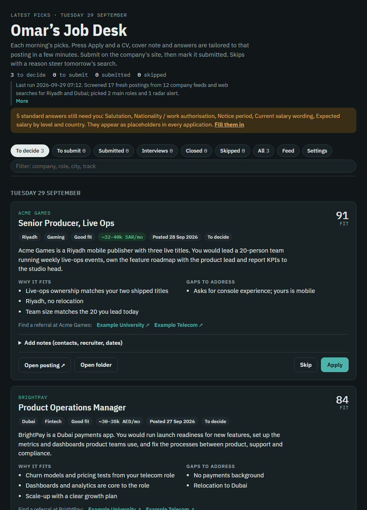

# Job Desk

  [](https://github.com/sponsors/achrabieh)

A personal job-search assistant that runs on your own PC with Claude Code.

- **Every morning** it screens 12–20 fresh postings against your criteria and puts the best 4–5 on a private review page, each with a plain description of the job, why it fits, the gaps, and a pay estimate.
- **Want more?** The Feed tab lists every role your company feeds matched today; add any of them to your picks in one click.
- **You press Apply or Skip.** Skip reasons steer tomorrow's picks.
- **Your CV, your design.** It reviews the CV you upload (what works, what to fix, and whether the photo suits where you are applying). Then you choose: keep your own design, keep it with the problems fixed, or switch to the clean Job Desk design. Keep your photo on every CV, leave it out, or let Claude decide per country.
- **On Apply** it builds a CV tailored to that posting, in your chosen design, a short cover note, and drafted answers to the usual screening questions, all from facts you approved. It never invents experience.
- **When you get an interview**, mark it and a prep pack is built: company briefing, your 60-second pitch, likely questions with answer outlines from your real stories, the gaps they'll probe, salary position and questions to ask.
- **You submit** on the company's site. Job Desk never submits, emails or creates accounts for you.



## Get it (Windows): no technical skills needed
**[Download JobDesk-Setup.exe](https://github.com/achrabieh/job-desk/releases/latest/download/JobDesk-Setup.exe)**, open it and click Install. Job Desk opens in your browser and walks you through everything else: signing in to Claude, uploading your CV, saying what you want, and picking companies.

You need a Claude Pro or Max plan. Windows may warn that the app is unrecognised: click **More info → Run anyway**. Step-by-step guide: [docs/INSTALL.md](docs/INSTALL.md).

## Updates
Job Desk checks GitHub for a new version twice a day and shows a banner when one is out. Press **Update now**: it downloads the new installer from this repository's releases, checks its SHA-256 fingerprint, installs it and reopens itself. Your data is never touched. You can also check under **Profile & settings → Updates**. To turn checks off, add `"check_updates": false` to `config.json` in your Job Desk folder.

## Support Job Desk
Job Desk is free and open source. If it helped you land interviews, you can support its development: **[♥ Sponsor Job Desk on GitHub](https://github.com/sponsors/achrabieh)**. Reporting problems in [Issues](https://github.com/achrabieh/job-desk/issues) and sharing it with friends who are job hunting helps too.

## For developers (any OS)
Requirements: Python 3.11+, [Claude Code](https://claude.com/claude-code) signed in once, and Edge/Chrome, Word or LibreOffice to export CV PDFs.
```
git clone https://github.com/achrabieh/job-desk.git
cd job-desk
pip install -r requirements.txt
python jobdesk/app.py --home ~/JobDesk      # opens the guided setup in your browser
```
The command line covers the same steps (`setup`, `onboard`, `daily`, `start`, `doctor`, `stats`): see [docs/SETUP.md](docs/SETUP.md). Helping a few friends start? See [docs/BETA.md](docs/BETA.md).

To build the Windows installer yourself: `installeruild.ps1` (needs Inno Setup 6). Pushing a `v*` tag builds it on GitHub and attaches it to the release.

## How it's organised
| Path | What it is |
|---|---|
| `jobdesk/server.py`, `jobdesk/dashboard.html` | The local review page (http://127.0.0.1:8765) and its tailoring queue |
| `jobdesk/cv/build_cv.py` | Builds a one-page CV (DOCX + PDF) from structured data |
| `jobdesk/ingest.py` | Pulls open roles from companies' public job feeds (list in `profile/boards.json`) |
| `jobdesk/factcheck.py` | Flags numbers and names in a tailored pack that aren't in your approved facts |
| `prompts/` | Instructions for the morning search and the tailoring run |
| `jobdesk/cli.py` | Command line: setup, onboard, start, daily, tailor, serve |
| `jobdesk/app.py`, `jobdesk/setup.html` | Desktop launcher and the guided setup in the browser |
| `installer/` | Windows installer (bundles its own Python) |
| `scripts/` | Windows wrappers around the command line |
| `profile.example/` | Starter profile files copied into your data folder |
| `docs/` | Setup guide, product plan |

Your data (profile, picks, decisions, CVs) lives in your own data folder, never in this repo.

## Safety rules built in
Full model, measured behaviour and known limits: [docs/SECURITY.md](docs/SECURITY.md).
- CV and cover-note content comes only from your fact bank; every build is checked to fit one page.
- Files carry normal document properties (your name as author, Word as creator).
- The agent may only read and write your data folder and this repo, and browse the web.

## Responsible use
- **You apply, not the tool.** Job Desk prepares applications; you read them and submit them yourself. It never fills in forms, sends emails or creates accounts.
- **Truthful by design.** CVs and cover notes are built only from facts you wrote in your fact bank, and every pack is checked for numbers and names that aren't there. Read the flagged items before you send anything.
- **Respect job sites.** It reads public job-board feeds (Greenhouse, Lever, Ashby, Workable, SmartRecruiters, Teamtailor, Workday) and normal web pages. Don't add sources whose terms forbid automated access.
- **Your data stays on your computer.** Profiles, picks and CVs live in your own data folder. The AI runs through your own Claude Code account; see [docs/SECURITY.md](docs/SECURITY.md).
- **Check your employment contract** before using it for anything beyond your own job search; some employers restrict outside activities.

## Contributing
Bug reports, new company feeds and new job-board parsers are welcome. See [CONTRIBUTING.md](CONTRIBUTING.md).

## License
AGPL-3.0. Job Desk stays open source: anyone may use, change and share it, and anyone who offers a modified version to others, including as a website, must publish their changes under the same licence. See [LICENSE](LICENSE).

Job Desk is an independent project. It is not affiliated with or endorsed by Anthropic, LinkedIn, or any employer or job board mentioned in this repository.
